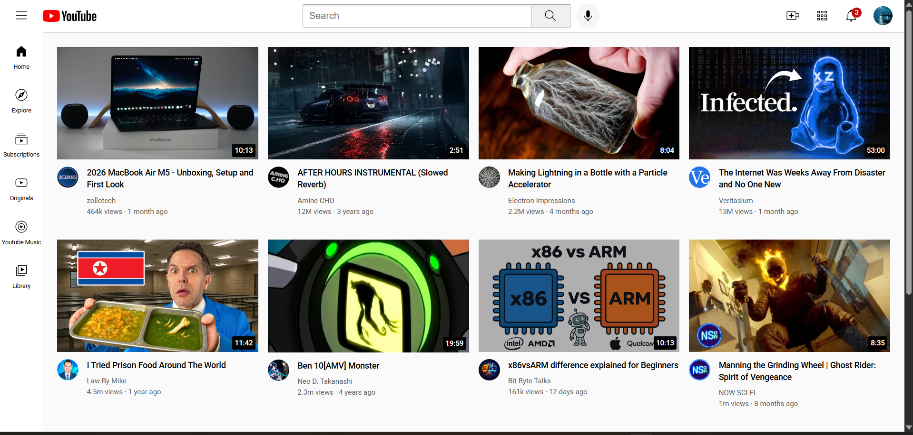
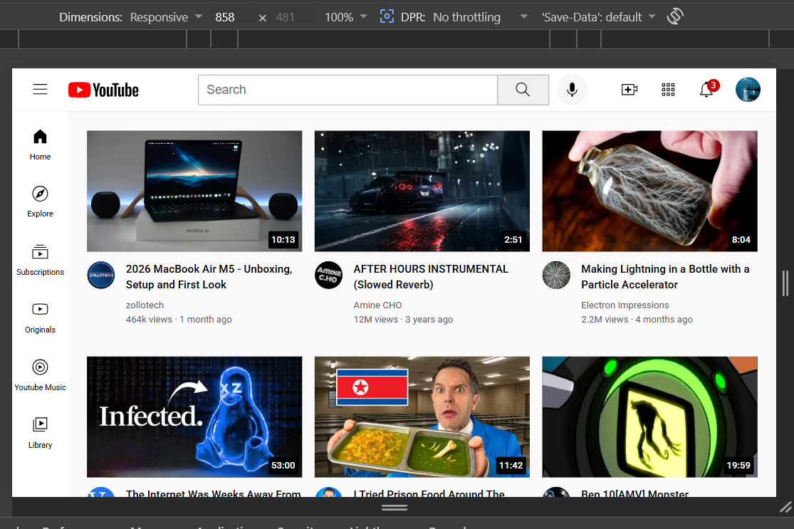

# 🎥 Video Streaming Platform (Frontend in Progress)

## 📌 Overview
This project is a responsive video streaming web interface inspired by YouTube currently built using **HTML and CSS**. The project focuses on recreating a modern video platform UI with strong emphasis on layout design, responsiveness, and user interface structure.

The project is currently under active development, with planned upgrades to add **JavaScript-based interactivity** and a **Java backend system** to evolve it into a full-stack project.

---

## 🎯 Current Features (Frontend)
- 🎥 YouTube-like homepage layout design  
- 🧭 Sidebar navigation UI  
- 🎞️ Video grid layout using CSS Grid and Flexbox  
- 📱 Responsive design( Video grid adjusts dynamically  )
- 🖼️ Video card UI with thumbnails  
- 🎨 Clean Code and structured UI styling  

---

## 🚧 In Development

### ⚡ Frontend Enhancements (Upcoming)
- JavaScript-based interactivity  
- Search functionality behavior  
- Dynamic UI components  
- Video page navigation  

### ☕ Backend Development (Planned)
- Java-based backend system  
- REST APIs for video data handling  
- User authentication system  
- Video upload and management features  
- Database integration  

---

## 🛠️ Tech Stack (Current)
- HTML5  
- CSS3 (Flexbox + Grid)
- CSS Media Queries 
- Responsive Web Design Principles  

---

## 📂 Project Structure
│── assets/screenshots
│── channel-picture
│── icons
│── styles/
     ├── general.css/
     ├── header.css/
     ├── sidebar.css
     ├── video.css
│── thumbnails/
│── index.html
│── youtube.html

---

## 🌐 Live Demo & Links

👉 **Live Demo:** https://freezed.netlify.app  
👉 **GitHub Repository:** https://github.com/kar18tikay-ctrl/Closer-website  

---

## 📸 Screenshots

### 🖥️ Desktop / 4-column layout view

    

---

### 🖥️ Narrow screen / 3-column layout view

    

---

## 🧠 Concepts Applied
- Real-world UI layout replication  
- CSS Grid and Flexbox for modern layouts  
- Responsive design for different screen size  
- Component-based UI thinking    

---

## 📈 Learning Outcomes
Through this project, I learned:
- How large-scale video platforms structure their UI
- Advanced CSS layout techniques
- Responsive design implementation
- Translating UI design into working frontend code
- Planning a project for full-stack expansion

---

## 🚀 Future Roadmap
- Add JavaScript-based interactivity (frontend logic)
- Build Java backend for handling video data
- Implement REST APIs for frontend-backend communication
- Add authentication system
- Improve search and recommendation features
- Expand into a complete video streaming platform

---

## 👤 Author
- GitHub: https://github.com/kar18tikay-ctrl/Closer-website  
- LinkedIn: https://www.linkedin.com/in/kartikay-b-b693a6282?utm_source=share_via&utm_content=profile&utm_medium=member_android     

---

## ⭐ Disclaimer
This project is built for learning purposes and is inspired by YouTube’s UI design. It is not affiliated with YouTube or Google in any way.
